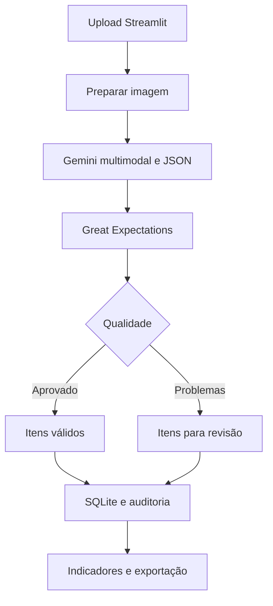

# Arquitetura

A interface Streamlit recebe uma ou mais imagens e chama o flow `process_menu`. Cada execução recebe UUID e SHA-256 da imagem. O banco persiste novos registros por append.

## Decisões

Escolhemos a abordagem multimodal para tratar texto, preços e relações espaciais na mesma chamada. Pydantic garante a estrutura, mas permite nulos para não esconder falhas de extração. Great Expectations verifica o conteúdo. Regras por item permitem apontar o motivo exato da quarentena. O banco conserva o JSON bruto e o relatório de validação.

O projeto não aceita preços absurdos silenciosamente: preços menores ou iguais a zero, acima do teto ou não finitos geram revisão. Um item com alerta permanece no banco para análise, com status separado. Nenhum valor é corrigido para aparentar qualidade.

## Métricas

- Missing: 100 × células nulas obrigatórias / total de células obrigatórias. Campos: categoria, nome, preço e moeda. Descrição é opcional e não entra no denominador.
- Preços razoáveis: 100 × itens com preço finito, positivo e até o teto / todos os itens extraídos, incluindo os sem preço.
- Latência: média dos segundos das execuções processadas, do recebimento de bytes até o commit de dados. Falhas aparecem separadamente.
- Custo: (tokens de entrada × tarifa de entrada + tokens de saída e pensamento × tarifa de saída) / 1.000.000. Tarifas vêm do .env e precisam corresponder ao modelo/nível de uso. Sem tarifa ou sem uso, custo desconhecido. Falhas de provedor sem uso retornado não são tratadas como gratuitas.

As métricas agregadas usam somas de numeradores e denominadores, não média simples dos percentuais por cardápio. Reexecuções contam no histórico. Para avaliação, utilize banco dedicado e um lote sem duplicatas. A meta de 50 exige imagens distintas e execuções processadas, mas quantidade não comprova acurácia.
